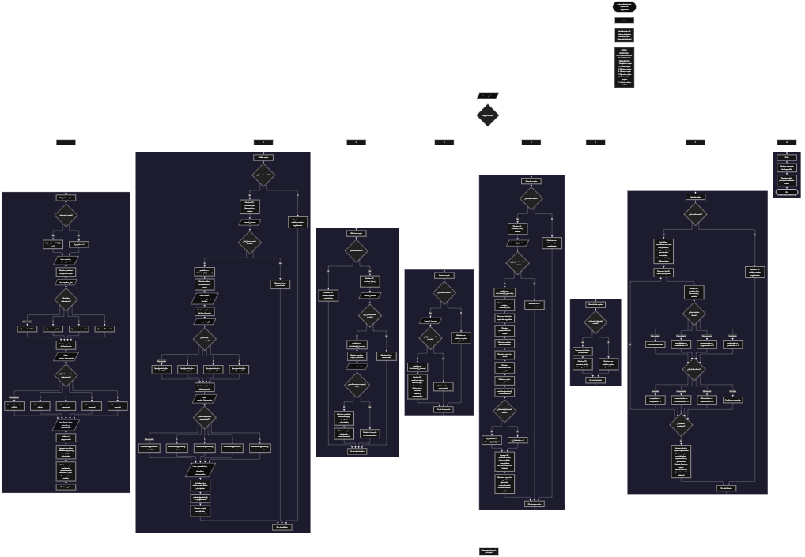

Este proyecto, llamado <b>automatizador de copias de seguridad</b>, fue desarrollado en <b>python</b> como un ejercicio práctico para fortalecer la lógica de programación mediante la creación de un sistema de gestión de copias de seguridad desde la consola. El programa cuenta con un menú principal de ocho opciones que permite <b>registrar, editar, eliminar, buscar, ejecutar y consultar el historial</b> de las copias de seguridad, además de visualizar los datos y las estadísticas de los registros almacenados. Cada copia contiene información como el nombre, origen, destino, tipo, frecuencia, fecha, hora, tamaño estimado, estado y observaciones, utilizando listas relacionadas para organizar los datos durante la ejecución. También incorpora un historial independiente que almacena información de las copias ejecutadas. Durante su desarrollo se aplicaron conceptos fundamentales de programación, como variables, listas, estructuras condicionales, ciclos repetitivos y métodos para agregar, modificar, buscar y eliminar registros. La ejecución de las copias se representa mediante una simulación de diferentes etapas del proceso, permitiendo poner en práctica los conocimientos adquiridos en Python y establecer una base para desarrollar sistemas de gestión más avanzados.

<h2 align="center">⚙️ Funcionamiento del menú principal</h2>

### ➕ Registrar copia

La opción <b>1) registrar copia</b> permite agregar una nueva copia de seguridad al sistema. Primero, el programa comprueba si existen registros almacenados mediante la función <b>len(ids)</b>. Si la lista está vacía, asigna el identificador inicial <b>1</b> a la nueva copia. En caso contrario, genera un nuevo identificador utilizando el último ID registrado más uno, mediante la expresión <b>ids[-1] + 1</b>. Después, solicita el <b>nombre, origen, destino, tipo, frecuencia, fecha, hora, tamaño estimado y observación</b> de la copia. Para seleccionar el tipo de copia, presenta tres alternativas: completa, incremental y diferencial. Asimismo, permite seleccionar una frecuencia diaria, semanal, mensual o manual. Si el usuario introduce una opción que no corresponde a las alternativas disponibles, el programa asigna el valor <b>"sin definir"</b>. Finalmente, establece el estado inicial como <b>"programada"</b> y almacena toda la información en sus respectivas listas mediante el método <b>append()</b>. Al terminar, muestra un mensaje de confirmación junto con el identificador, tipo, frecuencia y estado de la copia registrada.

### ✏️ Editar copia

La opción <b>2) editar copia</b> permite modificar la información de una copia de seguridad registrada. Primero, el programa comprueba si existen registros mediante la condición <b>len(ids) == 0</b>. Si no hay copias almacenadas, muestra el mensaje <b>"no existen copias registradas."</b>. En caso contrario, utiliza un ciclo <b>for</b> para recorrer las listas y mostrar el identificador, nombre, tipo, frecuencia y estado de cada copia. Después, solicita el ID de la copia que se desea editar y comprueba si existe mediante la condición <b>id_buscar in ids</b>. Si encuentra una coincidencia, obtiene su posición utilizando el método <b>index()</b> y muestra los datos actuales. A continuación, solicita el nuevo nombre, origen, destino, tipo, frecuencia, fecha, hora, tamaño estimado y observación, actualizando directamente los valores de las listas correspondientes. Para finalizar, establece nuevamente el estado de la copia como <b>"programada"</b> y muestra el mensaje <b>"copia actualizada correctamente."</b>. Si el identificador introducido no corresponde a ninguna copia registrada, presenta el mensaje <b>"id no encontrada."</b>.

### 🗑️ Eliminar copia

La opción <b>3) eliminar copia</b> permite eliminar una copia de seguridad registrada mediante su identificador. Antes de comenzar, el programa comprueba si existen registros almacenados. Si no hay copias, muestra el mensaje <b>"no existen copias registradas."</b>. Si existen registros, presenta una lista con el ID, nombre, tipo y estado de cada copia. Después, solicita el identificador de la copia que se desea eliminar y comprueba que exista dentro de la lista <b>ids</b>. Si encuentra el registro, obtiene su posición mediante el método <b>index()</b> y muestra el nombre, origen y destino de la copia seleccionada. Posteriormente, solicita una confirmación para realizar la eliminación. Si el usuario introduce la letra <b>"S"</b>, el programa utiliza el método <b>pop()</b> para eliminar la información correspondiente de las once listas principales: <b>ids, nombres, origenes, destinos, tipos, frecuencias, fechas, horas, tamanos, estados y observaciones</b>. Finalmente, muestra el mensaje <b>"copia eliminada correctamente."</b>. Si el usuario no confirma la operación, presenta el mensaje <b>"la copia no fue eliminada."</b>. El historial de ejecuciones no se modifica durante esta operación, por lo que los registros históricos permanecen almacenados.

### 🔎 Buscar copia

La opción <b>4) buscar copia</b> permite localizar y consultar una copia de seguridad mediante su identificador. Primero, el programa comprueba si existen registros almacenados. Si no hay copias, muestra el mensaje <b>"no existen copias registradas."</b>. En caso contrario, solicita el ID de la copia que se desea buscar y verifica su existencia mediante la condición <b>id_buscar in ids</b>. Si encuentra el identificador, utiliza el método <b>index()</b> para obtener la posición correspondiente y muestra toda la información almacenada: <b>ID, nombre, origen, destino, tipo, frecuencia, fecha, hora, tamaño, estado y observación</b>. Si el identificador introducido no se encuentra en la lista, presenta el mensaje <b>"id no encontrada."</b>. Esta función facilita consultar los datos completos de una copia sin modificar la información registrada.

### ▶️ Ejecutar copia

La opción <b>5) ejecutar copia</b> permite seleccionar una copia de seguridad registrada y simular su proceso de ejecución. Primero, el programa comprueba si existen copias almacenadas. Si no hay registros, muestra el mensaje <b>"no existen copias registradas."</b>. Si existen copias, presenta una lista con el ID, nombre, tipo y estado de cada registro. Después, solicita el identificador de la copia que se desea ejecutar y comprueba que exista dentro de la lista <b>ids</b>. Si encuentra la copia, obtiene su posición mediante el método <b>index()</b> y muestra su nombre, origen, destino y tipo. A continuación, presenta diferentes etapas que representan el proceso de ejecución: <b>"preparando copia", "analizando información", "copiando datos" y "verificando respaldo"</b>. Una vez finalizada la simulación, cambia el estado de la copia a <b>"completada"</b>. Posteriormente, genera un identificador independiente para el historial y almacena el nombre, fecha, hora y estado de la ejecución en las cinco listas correspondientes mediante <b>append()</b>. Finalmente, muestra el mensaje <b>"copia de seguridad ejecutada correctamente."</b> y presenta el nuevo estado del registro. Es importante tener en cuenta que esta operación representa una simulación en consola y no realiza la copia física de archivos entre las ubicaciones de origen y destino.

### 📜 Historial de copias

La opción <b>6) historial de copias</b> permite consultar los registros de las copias de seguridad que han sido ejecutadas. Primero, el programa comprueba si existen registros en la lista <b>historial_ids</b>. Si está vacía, muestra el mensaje <b>"no existen copias ejecutadas."</b>. En caso contrario, utiliza un ciclo <b>for</b> para recorrer las listas del historial y mostrar el identificador, nombre, fecha, hora y estado de cada ejecución. Cada vez que se ejecuta una copia mediante la opción anterior, se genera un nuevo identificador para el historial y se almacenan los datos correspondientes en las listas <b>historial_ids, historial_nombres, historial_fechas, historial_horas y historial_estados</b>. Esta organización permite conservar un registro independiente de las ejecuciones realizadas, incluso cuando una copia se elimina posteriormente de las listas principales.

### 📊 Lista de datos

La opción <b>7) lista de datos</b> permite visualizar las copias de seguridad registradas y consultar las estadísticas generales del sistema. Primero, el programa comprueba si existen registros almacenados mediante la condición <b>len(ids) == 0</b>. Si no hay copias, muestra el mensaje <b>"no existen copias registradas."</b>. Si existen registros, inicializa los contadores <b>completadas, programadas, pendientes, completas, incrementales y diferenciales</b> en cero. Después, utiliza un ciclo <b>for</b> para recorrer las listas principales y mostrar el ID, nombre, tipo, frecuencia y estado de cada copia. Durante el recorrido, utiliza estructuras condicionales para identificar el estado de cada registro e incrementar el contador correspondiente. También comprueba el tipo de copia para contabilizar las completas, incrementales y diferenciales. Al finalizar, presenta las estadísticas del sistema, incluyendo el total de copias registradas mediante <b>len(ids)</b>, la cantidad de copias completadas, programadas y pendientes, los diferentes tipos de copias y el total de ejecuciones realizadas mediante <b>len(historial_ids)</b>. Esta función permite consultar de manera organizada el estado general de las copias y la actividad registrada en el historial.

### 🚪 Salir del menú principal

La opción <b>8) salir</b> permite finalizar la ejecución del programa. Cuando el usuario selecciona esta alternativa, el sistema muestra el mensaje <b>"gracias por utilizar el automatizador de copias de seguridad."</b> y utiliza la instrucción <b>break</b> para interrumpir el ciclo <b>while True</b> que mantiene activo el menú principal. De esta manera, el programa finaliza su ejecución cuando el usuario selecciona la opción correspondiente.

<h2 align="center">🧠 Temas aplicados en el proyecto</h2>

### 📦 Variables

En este proyecto se utilizan variables para almacenar la información de las copias de seguridad, controlar las opciones del menú, generar identificadores, seleccionar los registros que se desean editar, eliminar, buscar o ejecutar, y contabilizar las estadísticas del sistema. También se utilizan variables para almacenar las opciones de selección del tipo y frecuencia de las copias, así como los datos temporales introducidos por el usuario durante cada operación.

🔢 **Opcion:** Almacena la opción seleccionada por el usuario en el menú principal.

🆔 **Id_copia:** Almacena el identificador generado para una nueva copia de seguridad.

🆔 **Id_buscar:** Almacena el identificador de la copia que se desea localizar.

▶️ **Id_ejecutar:** Almacena el identificador de la copia que se desea ejecutar.

📍 **Posicion:** Almacena la posición correspondiente al registro encontrado en las listas principales.

🔄 **I:** Funciona como contador en los ciclos utilizados para recorrer y mostrar los registros.

📋 **Opcion_tipo:** Almacena la alternativa seleccionada para determinar el tipo de copia de seguridad.

🕒 **Opcion_frecuencia:** Almacena la alternativa seleccionada para determinar la frecuencia de la copia.

📝 **Confirmacion:** Almacena la respuesta del usuario antes de eliminar una copia.

📊 **Completadas, programadas y pendientes:** Almacenan las cantidades de copias según su estado.

📈 **Completas, incrementales y diferenciales:** Almacenan las cantidades de copias según su tipo.

🆔 **Id_historial:** Almacena el identificador generado para cada nuevo registro del historial.

### 🗃️ Listas principales

En este proyecto se utilizan once listas relacionadas para almacenar la información de las copias de seguridad. Cada lista contiene un tipo de dato correspondiente a los registros y utiliza la misma posición para representar la información de una misma copia. Por ejemplo, los datos de una copia almacenada en la posición <b>0</b> se encuentran distribuidos entre <b>ids[0], nombres[0], origenes[0], destinos[0], tipos[0], frecuencias[0], fechas[0], horas[0], tamanos[0], estados[0] y observaciones[0]</b>. Esta organización permite registrar, consultar, modificar, eliminar y recorrer los datos de cada copia mediante sus posiciones correspondientes.

🆔 **Ids:** Almacena los identificadores de las copias registradas.

📝 **Nombres:** Almacena los nombres de las copias de seguridad.

📂 **Origenes:** Almacena las ubicaciones de origen de los datos.

📁 **Destinos:** Almacena las ubicaciones de destino de las copias.

🔧 **Tipos:** Almacena los tipos de copia: completa, incremental o diferencial.

🕒 **Frecuencias:** Almacena la frecuencia programada de cada copia.

📅 **Fechas:** Almacena las fechas programadas.

⏰ **Horas:** Almacena los horarios programados.

💾 **Tamanos:** Almacena los tamaños estimados de las copias.

📊 **Estados:** Almacena los estados actuales de las copias.

📄 **Observaciones:** Almacena información adicional de cada registro.

### 📜 Listas del historial

Además de las listas principales, el programa utiliza cinco listas independientes para almacenar la información de las copias de seguridad ejecutadas. Estas listas mantienen una relación entre sí mediante sus posiciones, permitiendo identificar cada ejecución y consultar sus datos correspondientes. A diferencia de las listas principales, los registros del historial no se eliminan cuando se borra una copia de seguridad, por lo que permiten conservar la información de las ejecuciones anteriores durante la ejecución del programa.

🆔 **Historial_ids:** Almacena los identificadores independientes de las ejecuciones.

📝 **Historial_nombres:** Almacena los nombres de las copias ejecutadas.

📅 **Historial_fechas:** Almacena las fechas asociadas a las ejecuciones.

⏰ **Historial_horas:** Almacena las horas asociadas a las ejecuciones.

📊 **Historial_estados:** Almacena los estados de las ejecuciones registradas.

### 🔀 Estructuras condicionales

En este proyecto se utilizan las estructuras <b>if, elif y else</b> para controlar las diferentes operaciones del sistema. Estas condiciones permiten comprobar si existen copias registradas, verificar si un identificador se encuentra en las listas, determinar el tipo y la frecuencia seleccionados, controlar la confirmación antes de eliminar una copia y actualizar los contadores de las estadísticas. También permiten ejecutar las instrucciones correspondientes según la opción seleccionada en el menú principal y mostrar mensajes cuando el usuario introduce una alternativa que no corresponde a las opciones disponibles.

### 🔄 Estructuras repetitivas

En este proyecto se utilizan los ciclos <b>while</b> y <b>for</b>. El ciclo <b>while True</b> mantiene activo el menú principal y permite que el usuario realice diferentes operaciones hasta seleccionar la opción de salida, donde se utiliza <b>break</b> para finalizar el programa. Por otro lado, los ciclos <b>for</b> permiten recorrer las listas principales para mostrar los registros disponibles, consultar los datos de las copias y generar las estadísticas. También se utilizan para recorrer las listas del historial y presentar las ejecuciones realizadas.

### 🔢 Métodos y funciones aplicados en las listas

El programa utiliza diferentes funciones y métodos de Python para administrar la información almacenada. La función <b>len()</b> permite conocer la cantidad de elementos de una lista y comprobar si existen registros. El método <b>append()</b> permite agregar nuevos datos al final de las listas, mientras que <b>pop()</b> elimina un elemento de una posición determinada. También se utiliza <b>index()</b> para obtener la posición de un identificador encontrado y el operador <b>in</b> para comprobar si un identificador existe dentro de una lista. Por otra parte, la expresión <b>ids[-1]</b> permite acceder al último identificador registrado y generar uno nuevo a partir de su valor.

### 🔤 Métodos de cadenas

En este proyecto se utilizan los métodos <b>upper()</b> y <b>lower()</b> para realizar comparaciones y comprobaciones con cadenas de texto. El método <b>upper()</b> se utiliza durante la eliminación de una copia para convertir la confirmación introducida por el usuario a mayúsculas y comprobar si corresponde a la letra <b>"S"</b>. Por otro lado, el método <b>lower()</b> se utiliza en las estadísticas para comparar los estados y tipos de copia sin depender de las mayúsculas o minúsculas de los valores almacenados.

### 🔗 Relación entre listas

Las listas principales y las listas del historial se organizan mediante posiciones relacionadas. En las listas principales, cada posición contiene los datos correspondientes a una misma copia de seguridad. De igual manera, las listas del historial utilizan el mismo índice para representar los datos de una misma ejecución. Esta organización permite acceder a la información de cada registro, modificar sus valores y mantener relacionados los datos almacenados en diferentes listas. Cuando se registra o elimina una copia, las operaciones se realizan en todas las listas principales para conservar la correspondencia entre sus posiciones.

### ⚙️ Simulación de procesos

El programa incorpora una simulación del proceso de ejecución de copias de seguridad mediante mensajes que representan diferentes etapas de trabajo. Durante esta operación se muestran las acciones de preparación, análisis de información, copia de datos y verificación del respaldo. Al finalizar, se actualiza el estado de la copia y se registra la ejecución en el historial. Esta implementación permite representar el funcionamiento general de un proceso de respaldo desde la consola, aunque no realiza operaciones físicas sobre los archivos o directorios.

### 📊 Contadores y estadísticas

El programa utiliza contadores para obtener información sobre las copias registradas. Antes de recorrer los registros, inicializa las variables correspondientes en cero. Después, mediante un ciclo <b>for</b> y estructuras condicionales, identifica el estado y el tipo de cada copia para incrementar el contador correspondiente. Finalmente, presenta los resultados junto con la cantidad total de registros y ejecuciones almacenadas. Este procedimiento permite obtener un resumen de la información gestionada por el sistema.

<h2 align="center">¿Cómo se implementaron las operaciones crud en el proyecto?</h2>

Las operaciones <b>crud</b> se implementaron mediante las opciones del menú principal, permitiendo administrar las copias de seguridad registradas. La operación <b>crear</b> corresponde a <b>registrar copia</b>, donde se introducen los datos de una nueva copia; <b>leer</b> se realiza mediante las opciones <b>buscar copia, historial de copias y lista de datos</b>, que permiten consultar los registros y las ejecuciones almacenadas; <b>actualizar</b> corresponde a <b>editar copia</b>, donde se modifican los datos de una copia existente; y <b>eliminar</b> se realiza mediante la opción <b>eliminar copia</b>, que permite retirar un registro de las listas principales. Adicionalmente, la opción <b>ejecutar copia</b> simula el proceso de respaldo y almacena cada ejecución en un historial independiente. Estas operaciones utilizan variables, listas, estructuras condicionales, ciclos y métodos de Python para gestionar la información durante la ejecución del programa.

<h2 align="center">Diagrama de flujo del proyecto</h2>

<h2 align="center">🛡️ Validaciones del programa</h2>

### 📭 No existen copias registradas

Esta validación se utiliza en las opciones de <b>editar, eliminar, buscar, ejecutar y lista de datos</b>. El programa comprueba si la lista <b>ids</b> está vacía mediante la condición <b>len(ids) == 0</b>. Si no existen copias registradas, muestra el mensaje <b>"no existen copias registradas."</b>. Esta comprobación evita continuar con las operaciones que necesitan información almacenada cuando no hay registros disponibles.

### 📜 No existen copias ejecutadas

Esta validación se utiliza en la opción <b>historial de copias</b>. El programa comprueba si la lista <b>historial_ids</b> está vacía. Si no existen ejecuciones almacenadas, presenta el mensaje <b>"no existen copias ejecutadas."</b>. De esta manera, evita intentar mostrar información del historial cuando todavía no se ha ejecutado ninguna copia de seguridad.

### ❌ ID no encontrada

Esta validación se utiliza durante las operaciones de <b>editar, eliminar, buscar y ejecutar copia</b>. El programa comprueba si el identificador introducido por el usuario existe dentro de la lista <b>ids</b> mediante el operador <b>in</b>. Si encuentra una coincidencia, utiliza el método <b>index()</b> para obtener la posición del registro y continuar con la operación correspondiente. Si el identificador no existe, muestra el mensaje <b>"id no encontrada."</b>, evitando realizar modificaciones o acciones sobre una copia que no está registrada.

### 🔧 Selección del tipo de copia

Esta validación se utiliza durante el registro y la edición de las copias de seguridad. El programa presenta tres alternativas para seleccionar el tipo de copia: completa, incremental y diferencial. Mediante las estructuras condicionales <b>if, elif y else</b>, comprueba la opción introducida por el usuario y asigna el valor correspondiente. Si la selección no coincide con ninguna alternativa, establece el tipo como <b>"sin definir"</b>.

### 🕒 Selección de la frecuencia

Esta validación se utiliza durante el registro y la edición de las copias. El programa presenta cuatro alternativas de frecuencia: diaria, semanal, mensual y manual. Mediante estructuras condicionales, comprueba la opción seleccionada y almacena el valor correspondiente en la lista <b>frecuencias</b>. Si el usuario introduce una alternativa diferente, asigna el valor <b>"sin definir"</b>.

### ⚠️ Confirmación de eliminación

Esta validación se utiliza antes de eliminar una copia de seguridad. Después de mostrar el nombre, origen y destino del registro seleccionado, el programa solicita una confirmación mediante la variable <b>confirmacion</b>. Utiliza el método <b>upper()</b> para convertir la respuesta a mayúsculas y comprobar si corresponde a la letra <b>"S"</b>. Si la respuesta es afirmativa, elimina el registro de las listas principales. En caso contrario, conserva la información y muestra el mensaje <b>"la copia no fue eliminada."</b>.

### 📊 Actualización de estados

El programa utiliza la lista <b>estados</b> para controlar la situación de cada copia de seguridad. Cuando se registra una nueva copia, su estado inicial es <b>"programada"</b>. Cuando se edita una copia, el estado vuelve a establecerse como <b>"programada"</b>. Por otro lado, cuando se ejecuta una copia mediante la opción correspondiente, el estado cambia a <b>"completada"</b>. Estos valores también se utilizan para generar las estadísticas del sistema.

### ⚠️ Opción inválida

El menú principal incluye una estructura condicional <b>if, elif y else</b> para comprobar la opción introducida por el usuario. Si el valor no corresponde a ninguna de las ocho alternativas disponibles, el programa ejecuta el bloque <b>else</b> y muestra el mensaje <b>"opción no válida."</b>. Esta comprobación permite informar al usuario cuando selecciona una opción que no está definida en el menú.

<h2 align="center">🎯 Objetivo del proyecto</h2>

El objetivo principal de este proyecto es fortalecer la <b>lógica de programación</b> mediante el desarrollo de un sistema de gestión de copias de seguridad en <b>python</b>. A través de su construcción se busca aplicar los conocimientos adquiridos sobre variables, listas, estructuras condicionales, ciclos repetitivos y métodos de manipulación de datos, integrándolos para resolver un problema de manera organizada. Además, el proyecto permite comprender cómo registrar, consultar, modificar y eliminar información, gestionar historiales de ejecución y generar estadísticas mediante una aplicación de consola. También permite explorar la representación de procesos de automatización mediante condiciones y secuencias de instrucciones, estableciendo una base para desarrollar sistemas de gestión más completos con otros lenguajes y tecnologías.

